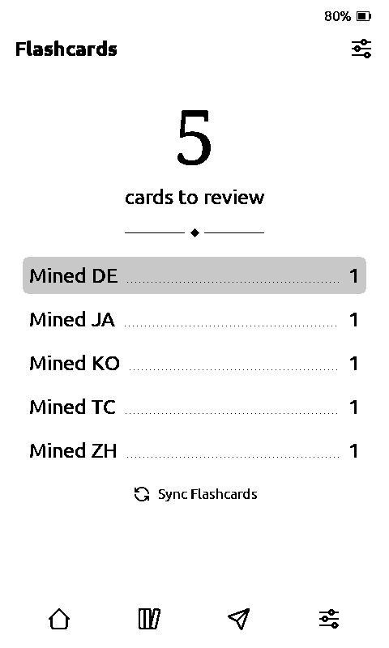
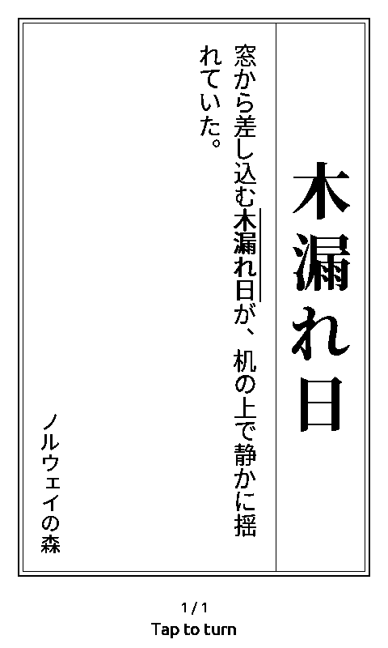
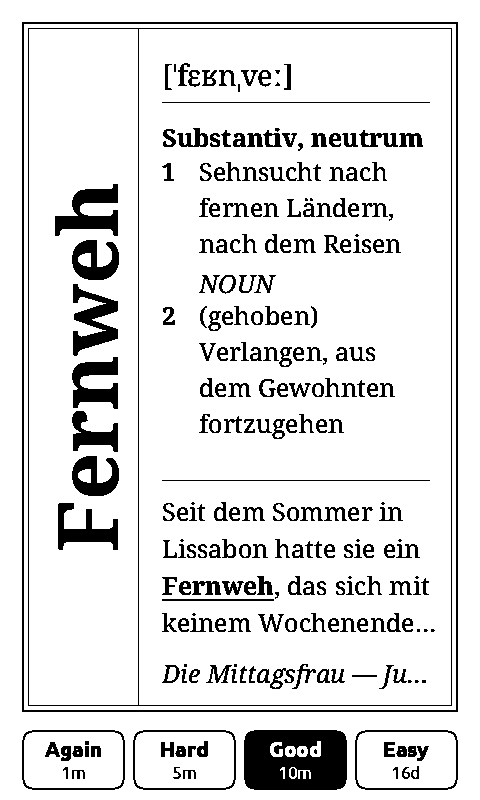
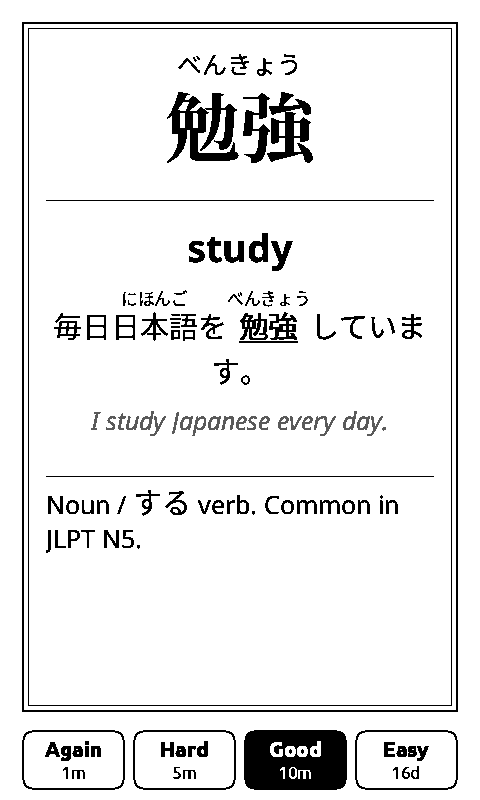
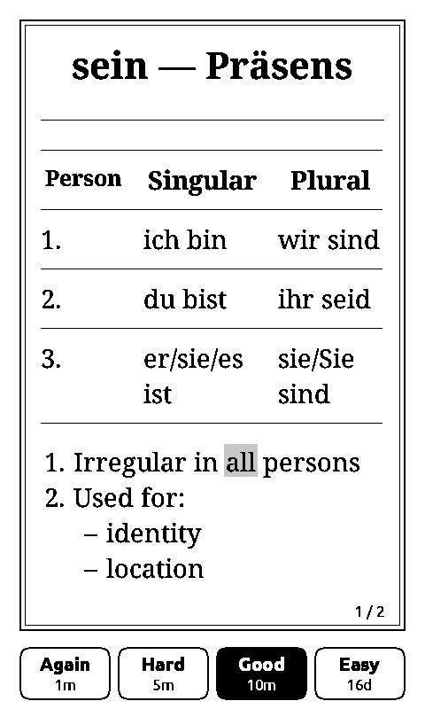

# dessen-matcha-plugins

[matcha-reader](https://github.com/eszter007/matcha-reader) features ported to
[CrossPoint](https://github.com/crosspoint-reader/crosspoint-reader) as
[Dessen](https://github.com/Free-Ink/dessen) apps: SD-card plugins, no firmware fork.

| Plugin | What it does |
|---|---|
| [Insights](plugins/insights) | matcha's Insights screen: streak, this week, books finished, days read, total time, longest streak, sessions, average session, month calendar, language tabs, and a page per book |
| [Flashcards](plugins/flashcards) | matcha's Flashcards, in Rust: Anki and Migaku decks synced through [matcha-anki-server](https://github.com/eszter007/matcha-anki-server), reviewed with FSRS-5 and Anki's learning steps, burying, Easy Days and leeches. Anki cards keep their CSS; words mined in matcha show on its spine card and can be reviewed before they reach Anki, then handed over. 37 languages. [User guide](plugins/flashcards/docs/GUIDE.md) |
| [Ticket](plugins/ticket) | matcha's end-of-book ticket: when you leave a book you read to the end, the cover and title on a torn ticket with a 読了 stamp and the start and finish dates, reading time and days on the stub, Home and Continue with the next book |

<p>





</p>

## Requirements

CrossPoint built with Dessen apps enabled (`${dessen_apps.build_flags}` and
`${dessen_apps.lib_deps}` in the board's env), and **Settings → Connectivity →
Plugins** turned on.

## Install

Copy a folder from [`dist/`](dist) to `/plugins/` on the SD card, then restart
the device so the plugin's event subscription is picked up. It shows up under
**Home → Plugins**.

## Build

```sh
git clone --recurse-submodules https://github.com/eszter007/dessen-matcha-plugins
cd dessen-matcha-plugins
make
```

Needs a RISC-V GCC; the one PlatformIO installs for ESP32-C3/S3 is used by
default (`RISCV=` to point elsewhere). Output goes to `dist/<plugin>/`.

Rust plugins (a `Cargo.toml` in the plugin folder) also need Rust with the
bare-metal RV32IM target: `rustup target add riscv32im-unknown-none-elf`. They
use Dessen's generated Rust wrappers (`dessen/sdk/dessen.rs`, `include!`d), and
Cargo builds a static library exporting `main`, linked with the SDK's own
`crt0.S` and `app.ld` like a C app.

The Ticket's fonts are generated from a matcha-reader checkout:

```sh
python3 tools/matcha_fonts.py ../matcha-reader plugins/ticket/fonts \
  s=ubuntu_8_regular:0020-2FFF b10=ubuntu_10_bold:0020-2FFF b12=ubuntu_12_bold:0020-2FFF \
  j8=notosansjp_joyo_8_regular:2E80-FFEF j12=notosansjp_joyo_12_regular:2E80-FFEF
# Chinese ideographs the Japanese subsets lack, from Noto Sans CJK SC (needs Pillow):
python3 tools/matcha_fonts.py ../matcha-reader plugins/ticket/fonts \
  c8=@NotoSansCJKsc-Regular.otf:8:j8 c12=@NotoSansCJKsc-Regular.otf:12:j12
# matcha's stamps, pre-turned (the costliest part of a ticket to do on the device):
python3 tools/make_stamps.py ../matcha-reader plugins/ticket
```

The Flashcards plugin's data is generated the same way (sources: a matcha-reader checkout and
the Noto CJK fonts from [notofonts/noto-cjk](https://github.com/notofonts/noto-cjk)):

- `fonts/`: `tools/matcha_fonts.py` — card text faces `cs*`/`cn*` (Noto Serif/Sans, 12–40 pt,
  `text` set), CJK faces `k14*`, `k20*` (Noto Sans CJK SC/JP/TC/KR, `cjkall`/`kr` sets, which
  include the JIS and KS character sets), spine faces `sp`, `spk*`, `spmj` (Noto Serif Bold,
  Noto Serif CJK Bold), Arabic `ar*` and Hebrew `he*` (Noto Sans Arabic/Hebrew); `tc.bin` marks
  the ideographs only Traditional Chinese uses.
- `hyph/`: `python3 tools/matcha_hyph.py ../matcha-reader-migaku plugins/flashcards` (matcha's
  Liang patterns).
- `i18n/`: one JSON file per language code CrossPoint stores (`/.crosspoint/settings.json`);
  `EN.json` is the source.

## Notes for Dessen apps

- `DSN_BITMAP_MASK` draws **clear** bits (FreeInk's icon convention), not set
  bits as `dessen_abi.h` says.
- Apps get 64 KB unless they ask for more (`APP_MEM_<plugin>` in the Makefile;
  boards with PSRAM allow up to 4 MB), and `dsn_fs_read` reads whole files only.
- `dsn_bitmap` refuses a bitmap that runs off the screen; crop it first.
- Apps can only draw text upright and can't read the screen back. The ticket
  turns its text with the paper by drawing it itself, with matcha's UI fonts
  extracted by [`tools/matcha_fonts.py`](tools/matcha_fonts.py) (licences in
  `plugins/ticket/fonts/LICENSE.txt`).
- Icons are from [Tabler Icons](https://tabler.io/icons) (MIT), as in matcha.
