# Flashcards — user guide

matcha's Flashcards as a Dessen plugin for CrossPoint: your Anki and Migaku decks, and the
words you mined in matcha, reviewed on the e-reader with FSRS-5 and synced back through
[matcha-anki-server](https://github.com/eszter007/matcha-anki-server).

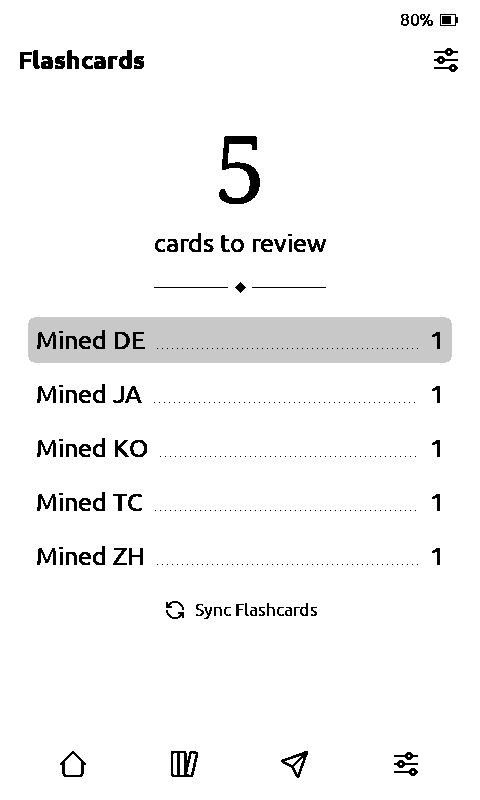
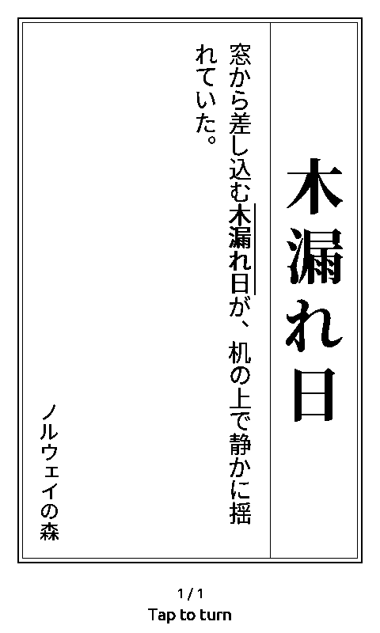
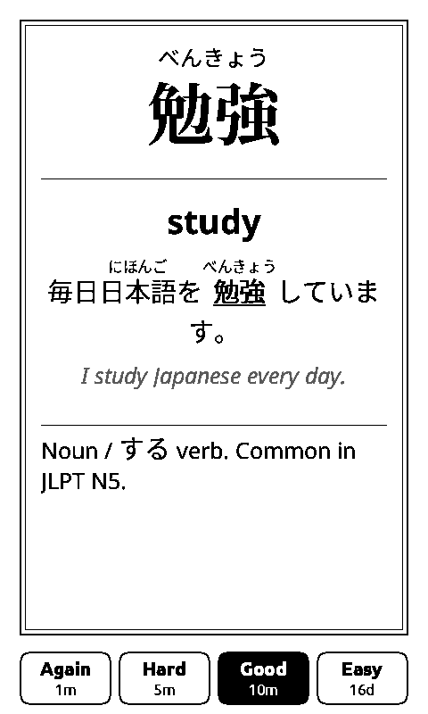
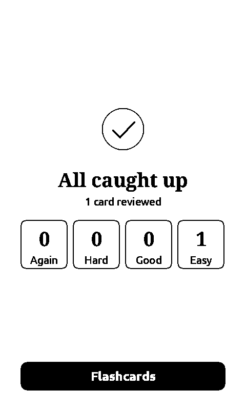

- [Install](#install)
- [Set up the sync](#set-up-the-sync)
- [The deck list](#the-deck-list)
- [Reviewing](#reviewing)
- [Anki cards](#anki-cards)
- [Words mined in matcha: the spine card](#words-mined-in-matcha-the-spine-card)
- [Mined words before they reach Anki](#mined-words-before-they-reach-anki)
- [Scheduling and vacation mode](#scheduling-and-vacation-mode)
- [How the sync works](#how-the-sync-works)
- [Languages](#languages)
- [Files on the SD card](#files-on-the-sd-card)
- [Limits](#limits)

## Install

You need:

- CrossPoint built with Dessen apps, and **Settings → Connectivity → Plugins** turned on
  (see the [repository README](../../../README.md)).
- A board with PSRAM: the plugin asks for 4 MB of app memory.
- About 170 MB free on the SD card, almost all of it fonts.
- [matcha-anki-server](https://github.com/eszter007/matcha-anki-server) running on your
  network, connected to Anki (and to Migaku if you use it).

Copy [`dist/flashcards`](../../../dist/flashcards) to `/plugins/flashcards` on the SD card and
restart the device. Flashcards shows up under **Home → Plugins**, and as a tab in the tab bar of
the Insights and Flashcards plugins.

## Set up the sync

Open Flashcards and choose the settings icon at the right of the title (or press Up from the
first row, then Confirm).

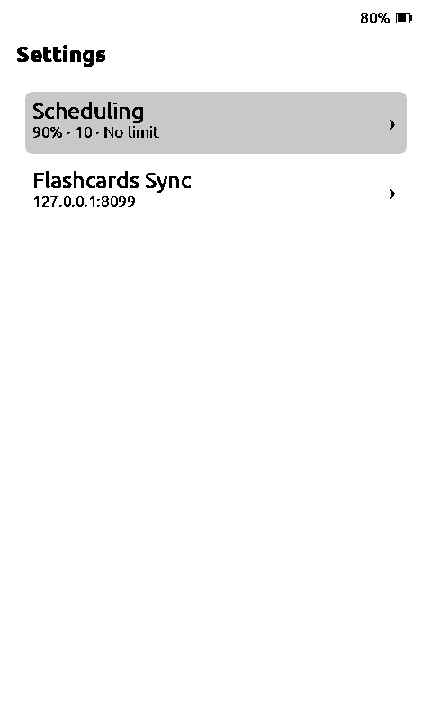
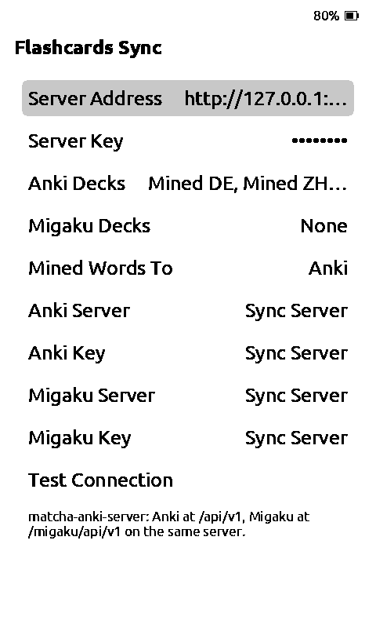

Under **Flashcards Sync**:

| Setting | What to enter |
|---|---|
| Server Address | The server, e.g. `http://192.168.1.2:8080` |
| Server Key | The server's key (`MATCHA_TOKEN` on the server) |
| Anki Decks | The Anki decks to review, comma separated, as Anki names them (`Kaishi 1.5k, Spanish::Verbs`) |
| Migaku Decks | The same for Migaku decks |
| Mined Words To | Where words mined in matcha go: Anki or Migaku |
| Anki Server / Anki Key | Only to reach Anki on another server (Anki Desktop) than the shared one |
| Migaku Server / Migaku Key | The same for Migaku |
| Test Connection | Connects to each server and checks the key, without syncing |

Text is typed on the firmware's keyboard. Then go back to the deck list and choose **Sync
Flashcards**. The first sync downloads every card and its pictures, which takes a while for a big
deck; later syncs only fetch new cards.

## The deck list

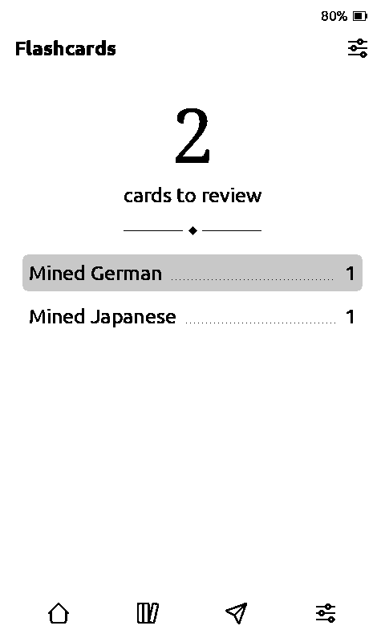

The big number is everything due today across your decks; each row shows one deck's due and new
cards for today. **Sync Flashcards** is the last row. A deck with nothing due does not open.

Keys: Up and Down move, Confirm opens. Down past the last row moves into the tab bar (Home,
Library, Transfer, Insights, Flashcards, Settings); Up/Down there pick a tab and Confirm switches.
Back closes the plugin.

## Reviewing

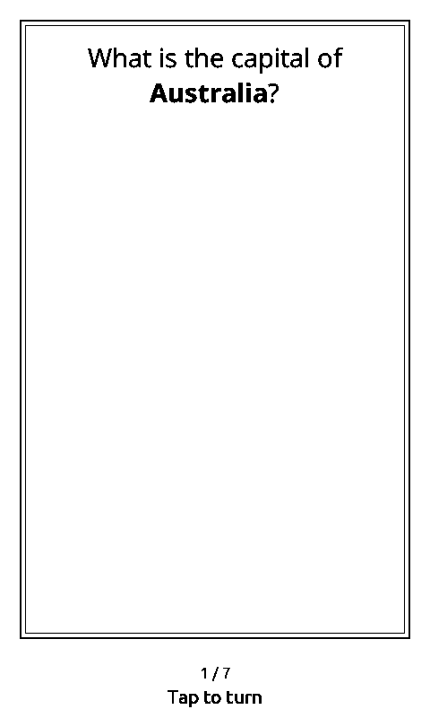
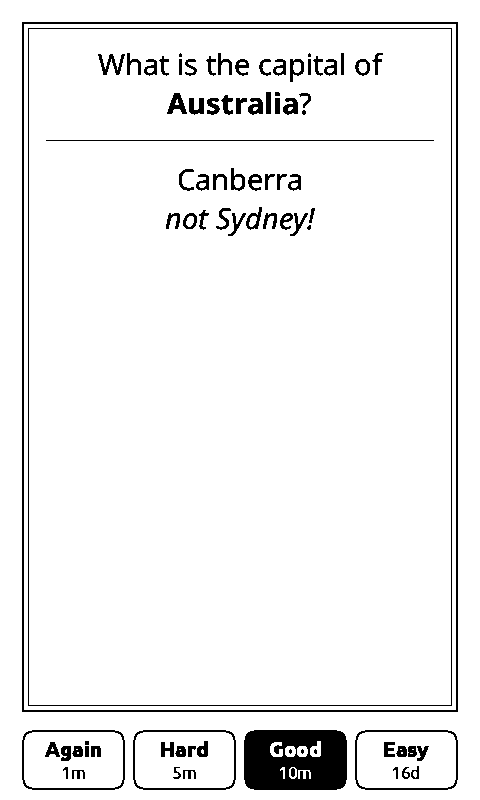

- **Turn the card:** tap it, or press Confirm or a side button.
- **Rate:** tap one of the four boxes, or move with Left/Right and press Confirm. Each box shows
  when the card comes back with that rating (`10m`, `3d`, `2mo`). Good is selected at first.
- **Long sides** split into pages (`1 / 2` at the bottom right); the side buttons page through
  them before they turn the card.
- **Back** leaves the session. Progress is saved after every rating, so leaving, sleep or a flat
  battery lose nothing.

When the session is done, **All caught up** shows how many cards you reviewed and how often you
gave each rating.

Scheduling follows matcha: FSRS-5 with your deck's desired retention and maximum interval, Anki's
learning and relearning steps, burying of siblings, Easy Days, and leeches (tagged, and suspended
if the deck's preset says so) — all from the deck's own Anki preset.

## Anki cards

Anki cards are laid out from their own HTML and their note type's CSS, so they keep their look.

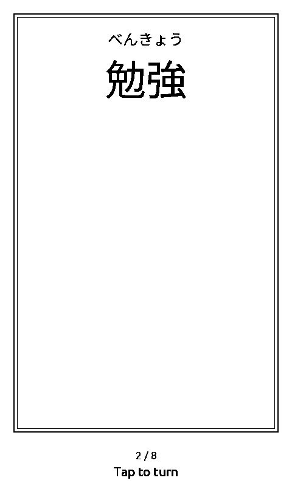

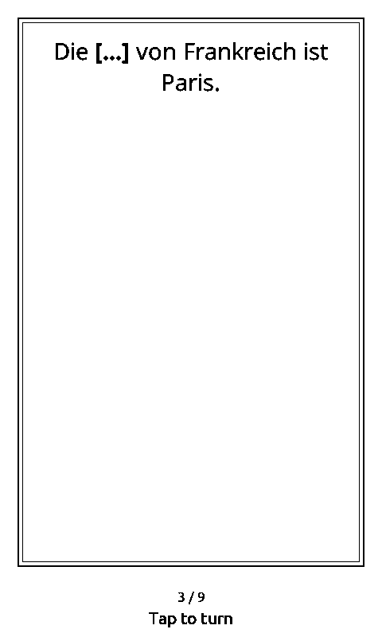
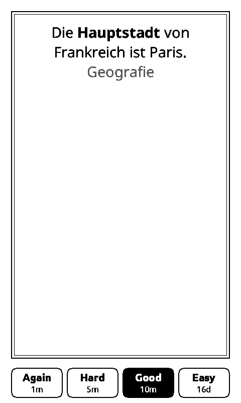

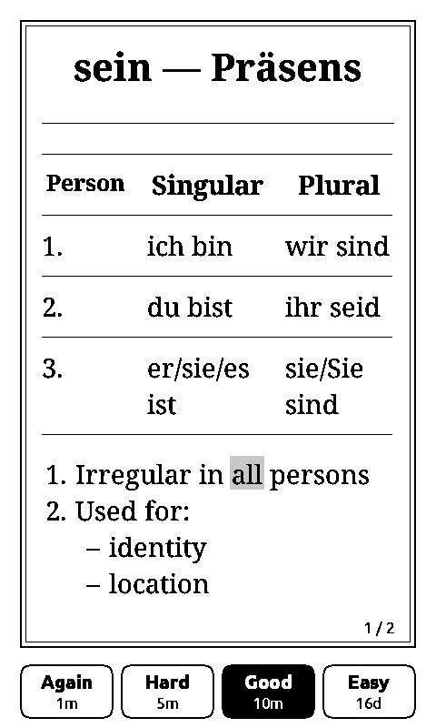
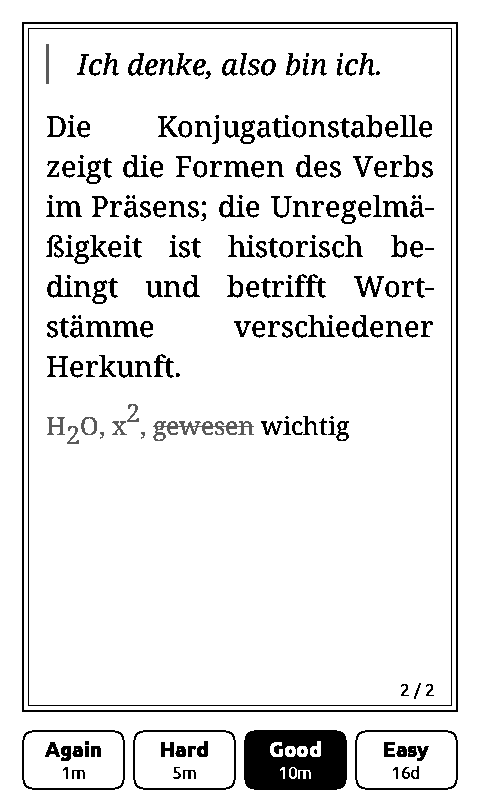
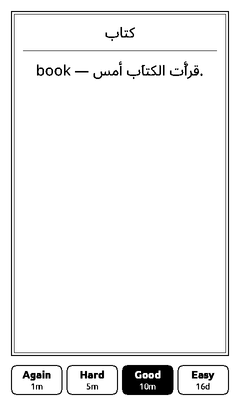
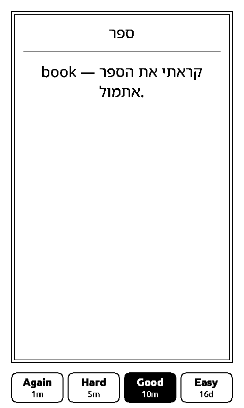

What the renderer handles:

- **Fonts:** Noto Serif or Noto Sans (from `font-family`), at eight sizes from 12 to 40 pt,
  regular, bold, italic and bold italic; Anki's 20 px text is set at 14 pt. Chinese, Japanese and
  Korean use the Noto CJK cut of the card's language, so 骨 or 漏 have their Japanese,
  Traditional or Korean shapes. A word too wide for the card steps down a size.
- **Text:** colour as black, or grey for light colours; highlights (`background`, `<mark>`);
  underline, strike-through, sub- and superscript; `line-height`; `text-transform`; justified
  text; hyphenation of Latin and Cyrillic words at their syllables in left-aligned and justified
  text (patterns for de, en, es, fi, fr, it, pl, pt, ru, sv, uk). The language comes from the
  card's own text when it tells (letters or common words); a card too short to tell uses its
  deck's language, guessed at sync from up to 80 of its cards (a `Matcha::<language>` deck from
  its name, a local deck of mined words from its file).
- **Blocks:** margins and padding, borders as rules (a left border as a bar, as in blockquotes),
  background bands, `text-align`, numbered and nested lists, tables with columns sized to their
  content, `
`, ` `, `display: none`.
- **Ruby:** furigana (Anki's `{{furigana:...}}`) and pinyin over their words.
- **Pictures:** sized by `width`/`height` attributes or CSS; small ones (icons, stars) sit in the
  line. They are stored as 1-bit pictures, dithered.
- **Right to left:** Arabic is joined, and Hebrew, Arabic and Persian are set right to left,
  also inside a left-to-right line (punctuation goes where the Unicode bidi rules put it).
- **Large CJK** (a 56 px word over its sentence) in Noto Sans CJK at 32 pt, or Noto Serif CJK
  Bold at 36 pt when bold.
- **Old decks:** ``, `align=`, `
`.

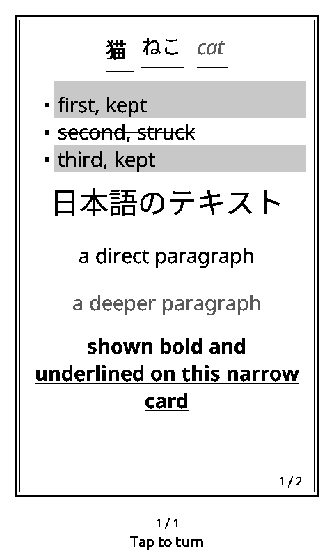
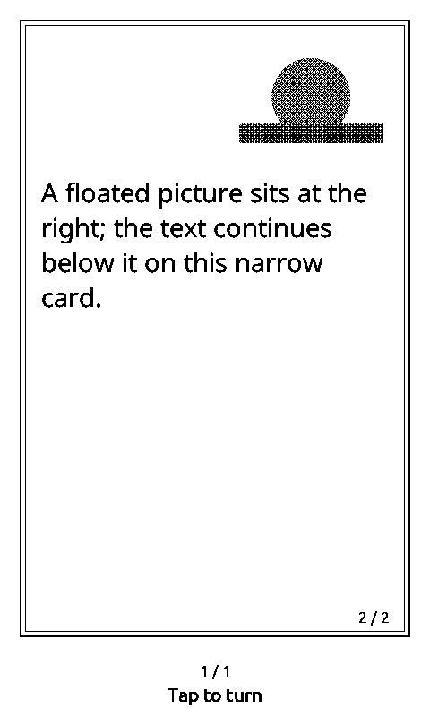

CSS selectors: tag, `.class`, `#id`, attribute tests (`[lang]`, `[lang=ja]`, `~=`, `^=`, `$=`,
`*=`, `|=`), descendant and child (`>`) combinators, `:first-child`, `:last-child`,
`:only-child`, `:nth-child()`, `:nth-last-child()`, `:not()` and `:root`, with CSS specificity.
`@media` rules apply as on a portrait screen in light mode at the card's width, so
`(max-width: …)` and `(orientation: portrait)` work and `print` or dark-mode rules do not.
Night mode classes never apply. `display: flex` lays a row's children side by side (column flex
stacks them); a floated picture goes to its side, with the text below it. Interaction states
(`:hover`, `:focus`), pseudo-elements (`::before`) and sibling combinators (`+`, `~`, read as
descendants) are left out.

## Words mined in matcha: the spine card

Notes of matcha's **Matcha sentence** type (the words you save while reading in matcha) are not
drawn from their HTML but on matcha's own card: the word along a spine like a book's back, the
sentence it came from beside it, and on the back the reading, the senses and the sentence again.

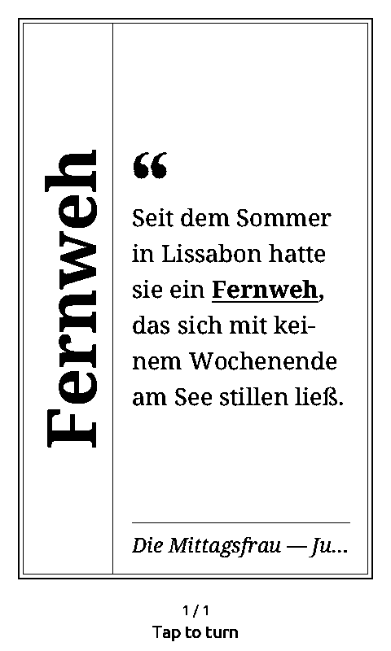
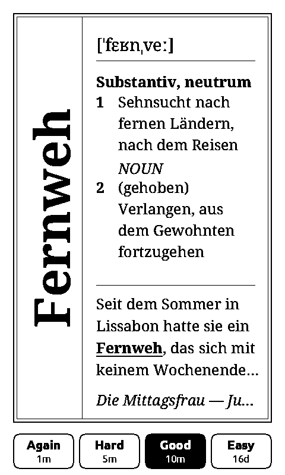

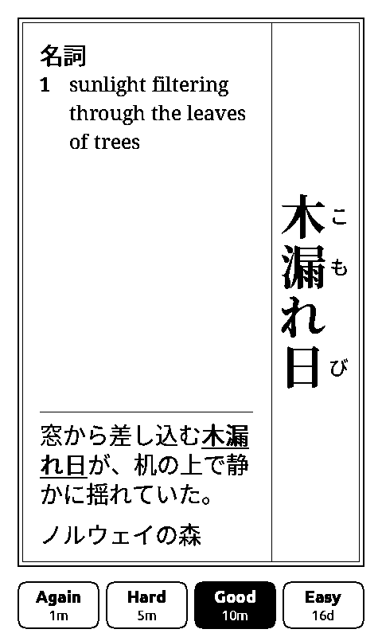

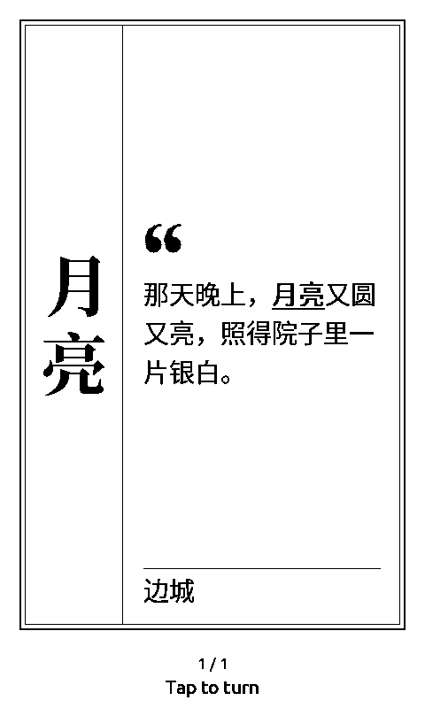
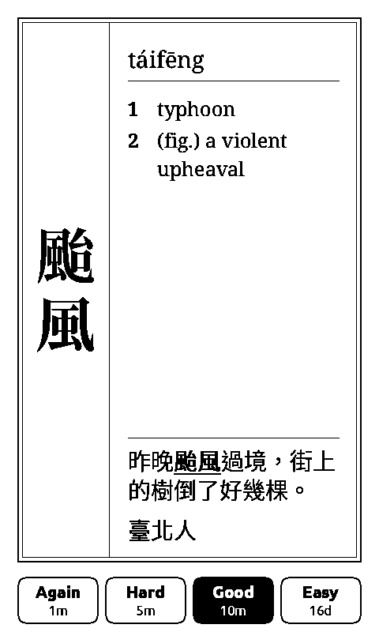
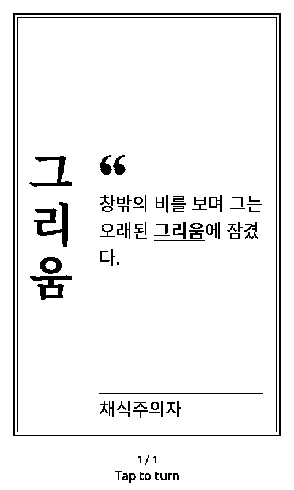
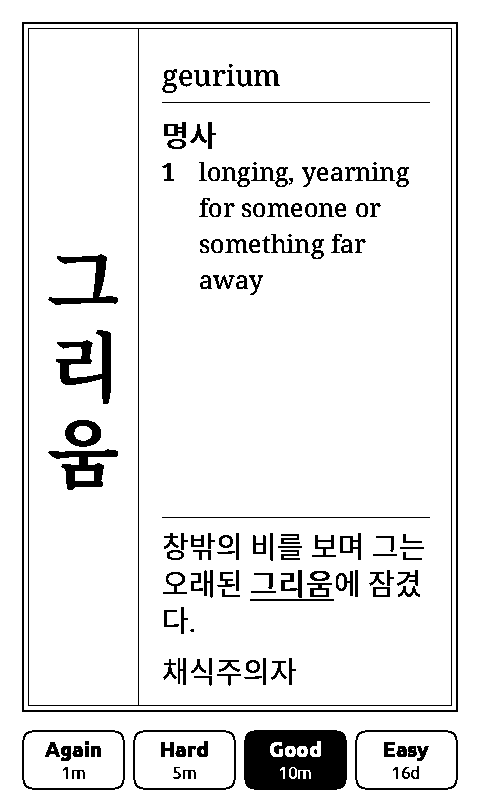

- **Latin and Cyrillic words** run up the spine in Noto Serif Bold; **Chinese, Japanese and
  Korean** stand upright down it, in Noto Serif CJK Bold of the word's language.
- **Front:** the sentence under a large opening quote, the saved word bold and underlined, the
  book's title at the foot.
- **Japanese** is bound on the right like a vertical book: the front reads in columns, and on the
  back the furigana stand beside each kanji of the word (from the note's Furigana field, or
  matched against the reading).
- **Back:** the reading (IPA and pinyin included), the numbered senses with the part of speech
  and grammar notes, then the sentence and the book.

The language is read from the text: kana mean Japanese, Hangul Korean, a character only
Traditional Chinese uses means Traditional, else Simplified.

## Mined words before they reach Anki

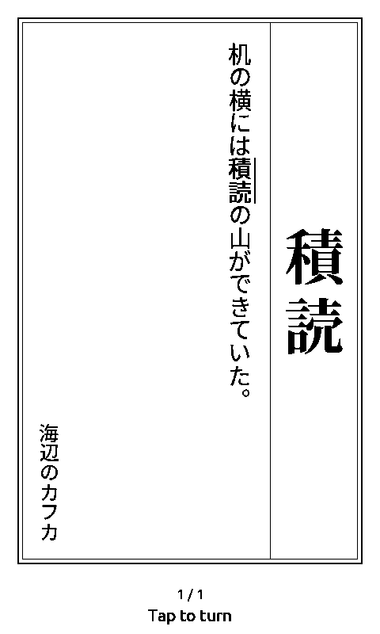
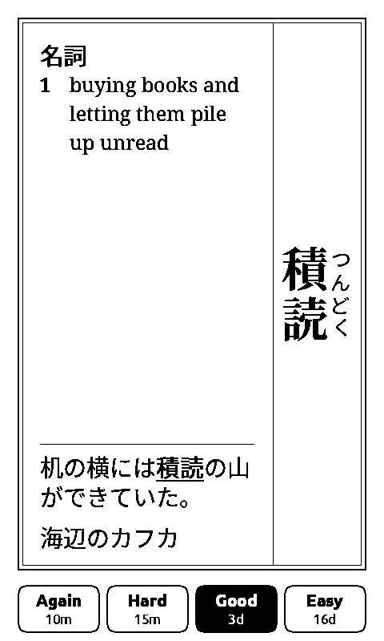

matcha keeps mined words in `/sentence-mining/sentences-<language>.csv`. When those files are on
the SD card, Flashcards lists one deck per language (**Mined German**, **Mined Japanese**, …) and
reviews them on the spine card, offline, before they ever reach Anki. Progress is matcha's own
file (`/.system/flashcards-<language>.bin`), so reviews done in matcha and in the plugin count
for both.

The next sync hands them over, as matcha does: each word not yet in Anki becomes a **Matcha
sentence** note in the deck `Matcha::<language>` (made in Anki if missing, and added to your
Anki or Migaku decks), its progress and review history move to the new card, and the local deck
leaves it out from then on. A word already in Anki (same word and sentence) is not added twice.
Words matcha handed over itself are left out too.

CrossPoint has no word lookup that could save words, so these files come from matcha.

## Scheduling and vacation mode

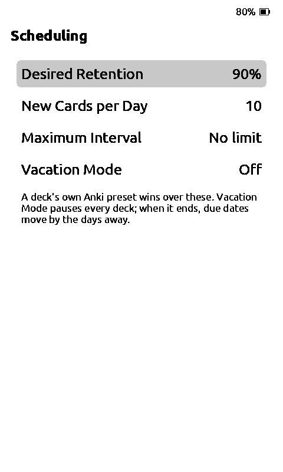

matcha's **Desired Retention** (80–95 %), **New Cards per Day** (5–50) and **Maximum Interval**
(1 month – no limit) apply to decks without an Anki preset: the local decks of mined words, and
any deck whose preset could not be read. A deck's own preset always wins.

**Vacation Mode** pauses every deck: the list shows *On vacation* and no cards come up. When you
turn it off, every card's due date moves forward by the days you were away, so nothing piles up.

## How the sync works

Each sync, per service (Anki, then Migaku):

1. The server syncs with AnkiWeb (or Migaku) first.
2. Mined words are handed over (to the service chosen in *Mined Words To*).
3. Per deck: its preset, new cards with their sides and pictures, Anki's reviews since the last
   sync, then the device's reviews and the resulting schedules go to Anki.
4. The server syncs with AnkiWeb again.

Cards that arrive already studied in Anki (a deck synced for the first time, or a mined word
already in Anki) start with their Anki progress: their review history is replayed and Anki's
FSRS memory taken over. A card with no history to replay (rescheduled by hand) takes Anki's
schedule as it is; this needs matcha-anki-server's `dessen` branch, which tells the device
Anki's day count (`device.today`), and otherwise counts the card due today.

The result shows per service: new cards, reviews received, reviews sent. If AnkiWeb could not be
synced it says so, and the next sync tries again. If AnkiWeb is waiting for you to choose which
copy to keep (a full sync), the sync stops before sending anything: choose in Anki, then sync
again.

A sync cannot be stopped half way (Dessen gives apps no way to check for a key while they work);
holding Back closes the plugin, and everything synced so far is kept.

## Languages

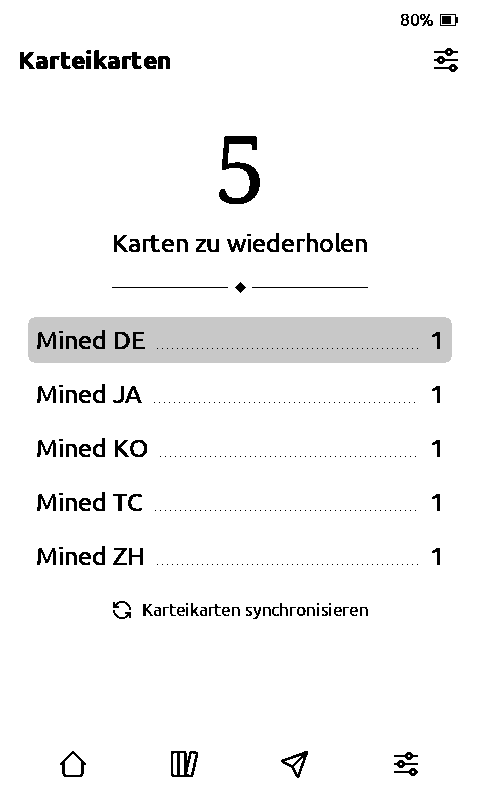
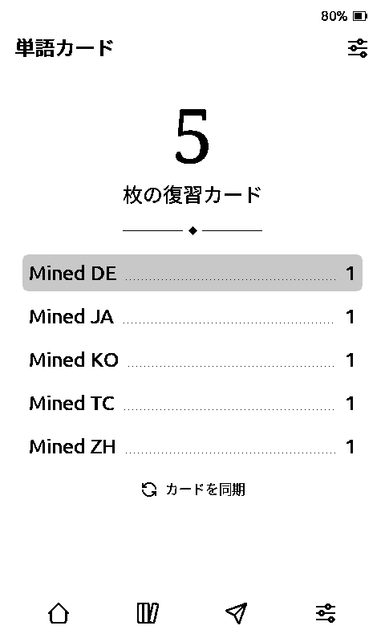
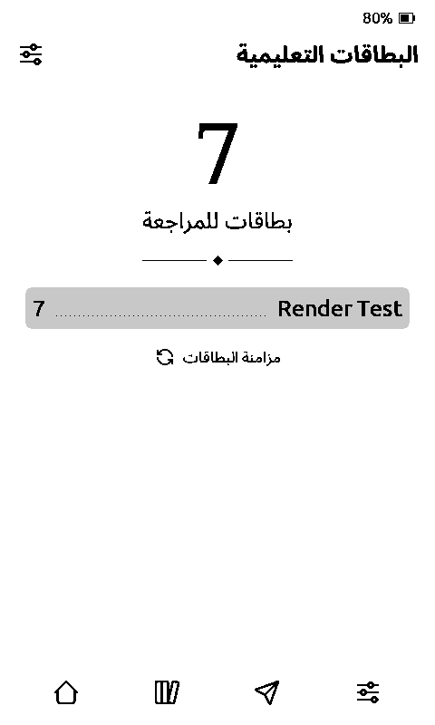
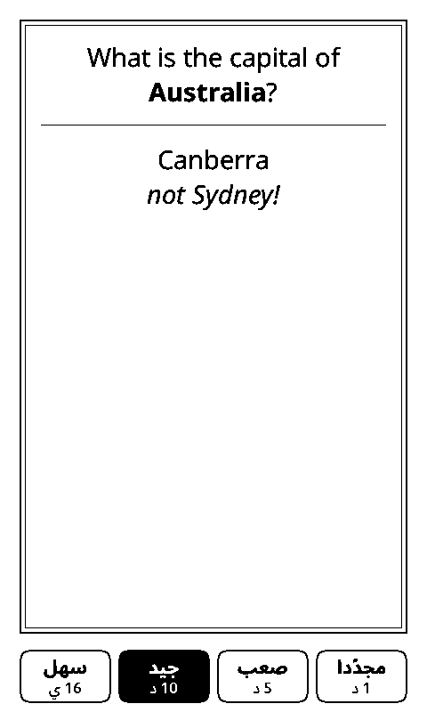

The plugin follows CrossPoint's language (Settings → Language), in all 37 of matcha's
languages, with matcha's plural rules. Arabic, Hebrew and Persian mirror the layout: titles and
labels on the right, Again on the right of the rating boxes.

Where Anki has the same term, the plugin uses Anki's own translation: the ratings (Again, Hard,
Good, Easy), Desired Retention, New cards/day, Maximum interval and the short time units under
the rating boxes. The rest of the plugin's words were machine-made and are not yet checked by
native speakers; corrections to `i18n/<language>.json` are welcome.

## Files on the SD card

In `/plugins/flashcards/`:

| File | What it holds |
|---|---|
| `config.json` | The settings: `server`, `key`, `anki`, `migaku`, `minedTo`, `ankiServer`, `ankiKey`, `migakuServer`, `migakuKey`, `retention`, `newPerDay`, `maxInterval`, `vacation` |
| `decks.json` | The decks the list shows |
| `<deck>.json`, `.ids`, `.cards`, `.state`, `.log`, `.steps`, `.leeches` | Per deck: its preset, cards, card sides, progress, unsent reviews, learning steps, new leeches |
| `css-*.css`, `img-*.bit` | Note type styles and pictures |
| `fonts/`, `hyph/`, `i18n/` | Fonts, hyphenation patterns, translations |

`config.json` can also be written by hand; the settings screen writes the same keys.

## Limits

- Pictures are black and white (dithered); matcha's greyscale pass needs firmware support.
- A sync cannot be stopped half way (see above).
- The plugin opens about a second after you choose it (the Home screen is drawn first), and the
  first sync of a big deck is slow: apps run in a sandbox at about 1.5 million instructions a
  second.
