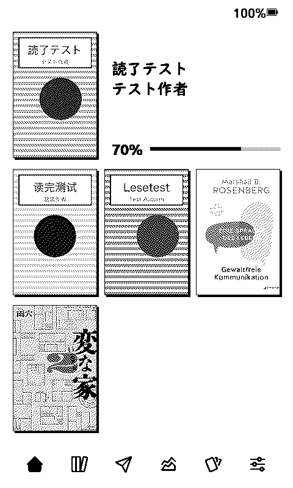

# Home

matcha's Home screen as a CrossPoint home launcher.

- **Top:** the book you are reading, with its cover, title, author and progress.
- **Grid:** the next six books, recently opened first, then recently added.
  A book you have never opened has a **New** tab on its cover.
- **Tab bar:** Home, Library, Transfer, Insights, Flashcards and Settings, as
  in matcha. Insights and Flashcards show only when those plugins are
  installed. Leaving them, or a book, brings you back here.

Tap a cover to open the book. With buttons, Up and Down move between the
covers and the tab bar, and Confirm opens the selected item.

## Setup

1. Copy `dist/home` to `/plugins/home` on the SD card.
2. Turn on **Settings → Connectivity → Plugins**.
3. Choose **Settings → Display → Home Launcher → Home**.

To go back to CrossPoint's own Home, set Home Launcher to **Default**. If the
launcher ever fails to start, hold **Back** and the device falls back to the
built-in Home.

Covers come from the firmware's thumbnail cache. The first time a book is
shown, its cover takes a moment to make. Titles use the firmware's UI font, so
characters missing from that font show as boxes, as on the built-in Home.
