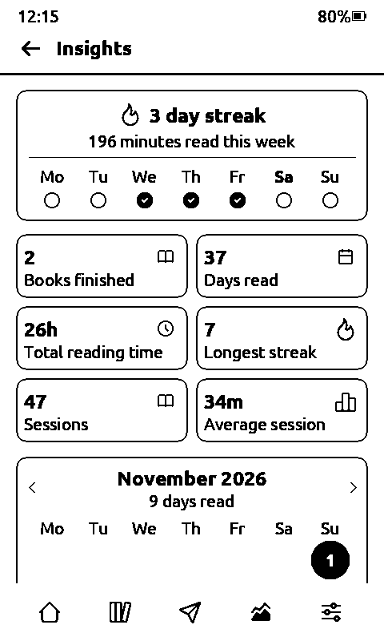
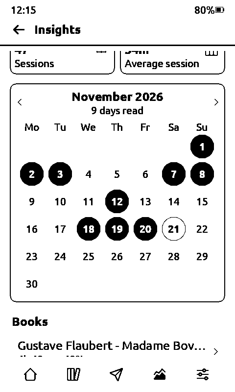

# Insights — user guide

matcha's Insights screen as a Dessen plugin for CrossPoint: how much and how often you read.

*Screenshots from the Dessen VM with a demo reading history.*

## What it shows

- **Streak and this week:** the days in a row you read, the minutes read this week, and which
  days of the week you read.
- **Totals:** books finished, days read, total reading time, longest streak, sessions and the
  average session.
- **Calendar:** a month at a time (‹ › to move), the days you read filled in, today ringed.
- **Books:** every book you read, newest first, with a tab per book language when you read in
  more than one. Open a book for its own page: its sessions, time, average session, days read,
  and a calendar marking the day you started and the day you finished.

A book counts as finished when you leave it past its last page.

## Install

Copy [`dist/insights`](../../../dist/insights) to `/plugins/insights` on the SD card and restart
the device. It needs a CrossPoint build with Dessen app-event handlers (`feat/dessen-apps`,
20 Nov 2026 or later) and the clock set.

## How it collects

The reader reports each reading session (`reader.session`) and each time you leave a book
(`reader.exit`). The firmware keeps them in a small queue (4 KB, about a dozen sessions) in the
plugin's folder, and Insights folds them into `stats.db` each time you open it. The firmware drops
a full queue, so open Insights now and then.

The [Ticket](../../ticket/docs/GUIDE.md) and [Flashcards](../../flashcards/docs/GUIDE.md) plugins
share matcha's tab bar with it: Home, Library, Transfer, Insights, Flashcards and Settings. Tap a
tab, or press Down past the last row to move into the bar, Up/Down to pick a tab and Confirm.
