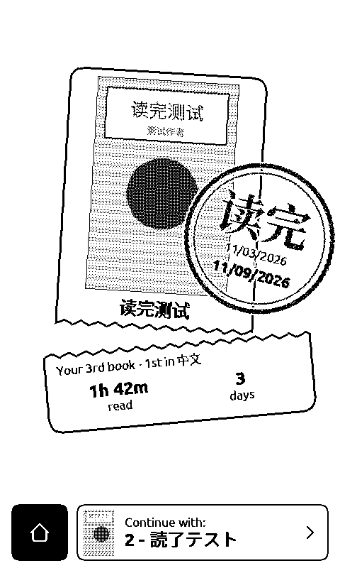
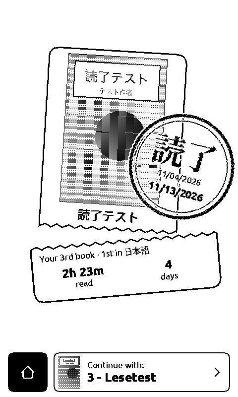
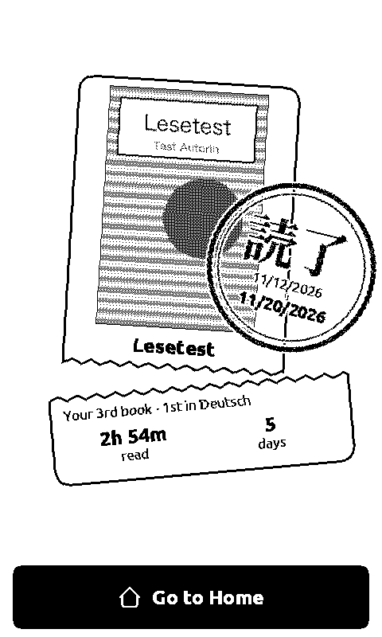

# Ticket — user guide

matcha's end-of-book screen as a Dessen plugin for CrossPoint: when you finish a book, it comes
back as a ticket torn in two.

*Screenshots from the Dessen VM with test books and a demo reading history.*

## What it shows

- **The top half:** the book's cover and title, with matcha's stamp: 読了 (Japanese and most
  languages), 读完 (Simplified Chinese), 讀完 (Traditional Chinese) or 睇完 (Cantonese), and the
  day you started and the day you finished.
- **The stub:** your Nth book overall and in its language, the reading time and the days you
  read it.
- **Below:** Home, and *Continue with* the next book in the same folder (with its cover).

It opens by itself when you leave a book you read to the end; Back returns to the book. Open it
from Plugins to see the ticket of the last book you finished.

## Install

Copy [`dist/ticket`](../../../dist/ticket) to `/plugins/ticket` on the SD card and restart the
device. The numbers come from the [Insights](../../insights/docs/GUIDE.md) plugin, so install
that too. It needs a CrossPoint build with Dessen app-event handlers (`feat/dessen-apps`,
20 Nov 2026 or later) on a board with PSRAM.

Text is drawn with matcha's own fonts, so it turns with the ticket as in matcha; the stamps are
pre-turned (`tools/make_stamps.py`). Lookups and saved sentences are not shown: CrossPoint does
not record them.
